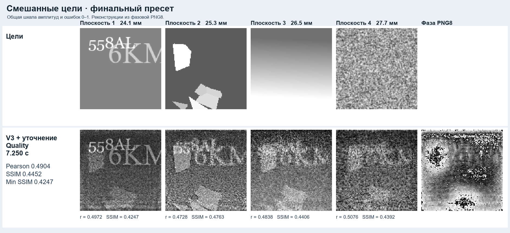
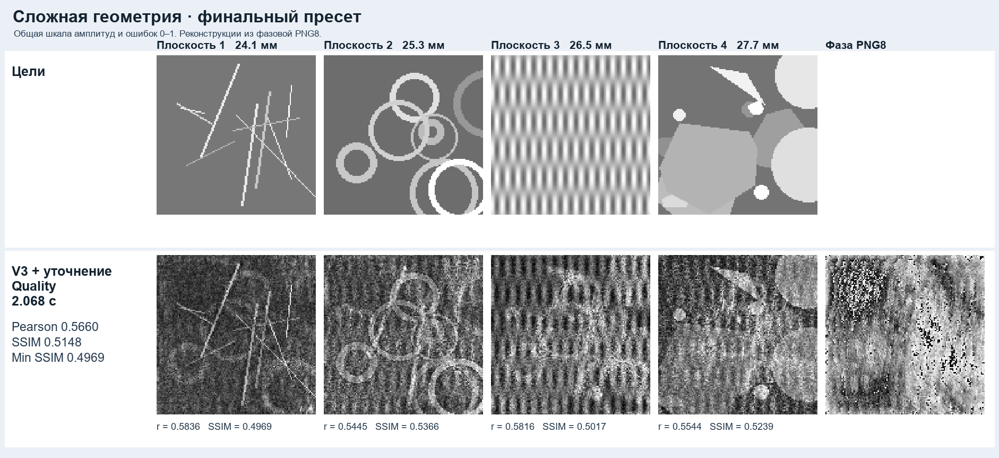
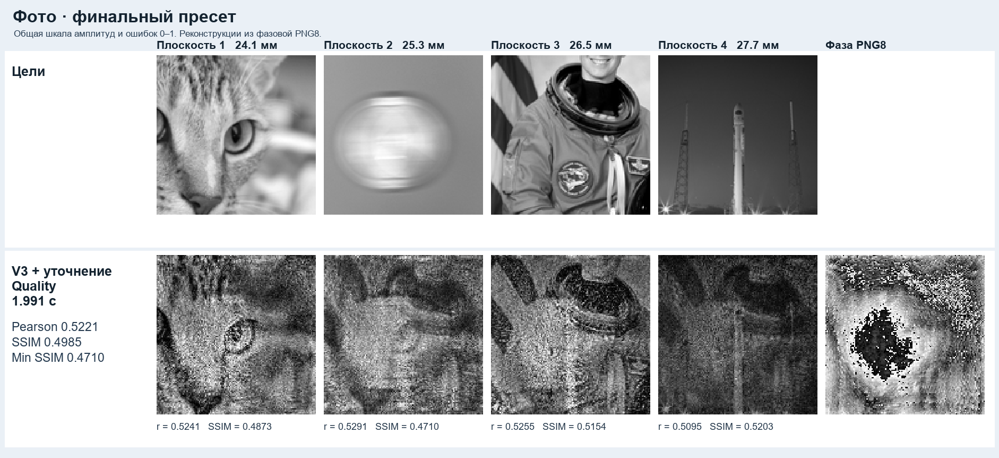
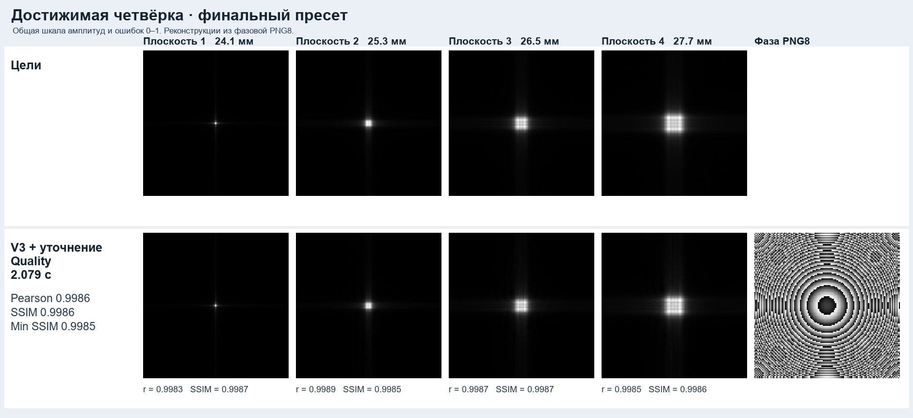
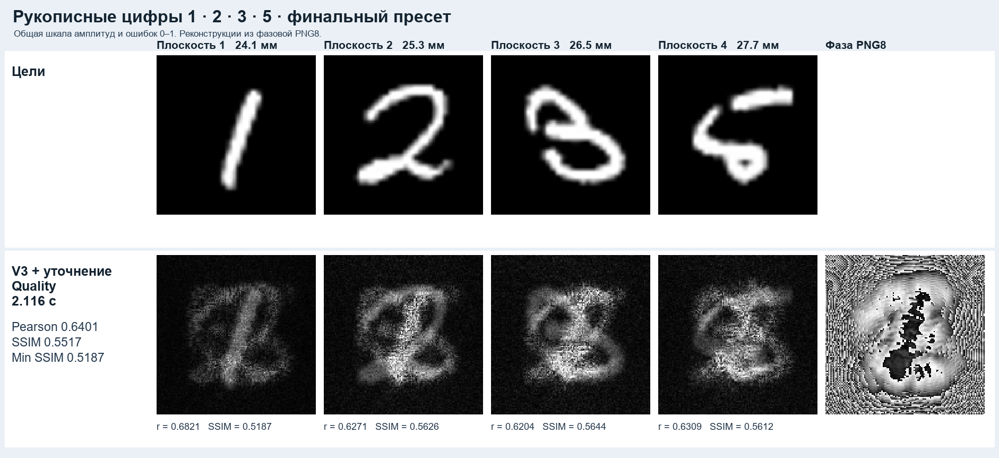

# AI Photonics · четырёхплоскостной нейросетевой ДОЭ

Система синтезирует одну фазовую маску 128×128 по четырём полутоновым целям. Веб-интерфейс показывает физически рассчитанные реконструкции после повторного чтения маски и позволяет скачать PNG или ZIP. (тз)

## Запуск

Из папки с Dockerfile:

    docker build -t neural-doe .
    docker run --rm -p 7860:7860 neural-doe

Откройте http://localhost:7860. Загрузите по одному PNG для глубин 24,1 / 25,3 / 26,5 / 27,7 мм и нажмите **Синтезировать ДОЭ**. Доступны два встроенных примера. Контейнер рассчитан на Linux x86-64 и CPU. Зависимости устанавливаются при сборке. Веса, конфигурация и примеры уже включены. После сборки доступ к сети для синтеза не требуется.

### Автоматическая проверка

В окружении Python 3.11 с установленными зависимостями:

    python -m pip install --index-url https://download.pytorch.org/whl/cpu torch==2.5.1+cpu
    python -m pip install -r requirements.txt
    python -m submission.predict --images a.png b.png c.png d.png --output doe_phase.png

CLI всегда выполняет Quality (было 2 варианта в конфиге указано, продублируем тут: метрика по времени была объяслена не сразу и не главной так что приоритет отдали метрикам качества, была разработала еще баланс версия она сходилась в несколько раз быстрее (3-8 выбивали), но по точности капельку уступала (порядок 0.02 на метрику), разница просто в глубине доводки). Дополнительные файлы создаются только с **--diagnostics-dir**. Веб-сервер запускается и локально командой **python -m submission.web**. В локальном окружении с CUDA-сборкой PyTorch можно задать **DOE_DEVICE=cuda**. Docker использует CPU-сборку PyTorch.

Поместите четыре файла в папку io. Для Linux/macOS:

    docker run --rm --user "$(id -u):$(id -g)" -v "$PWD/io:/io" neural-doe python -m submission.predict --images /io/a.png /io/b.png /io/c.png /io/d.png --output /io/doe_phase.png

Для Windows PowerShell с Docker Desktop:

    docker run --rm --mount "type=bind,source=$((Get-Item io).FullName),target=/io" neural-doe python -m submission.predict --images /io/a.png /io/b.png /io/c.png /io/d.png --output /io/doe_phase.png

Входные файлы должны быть PNG в режиме grayscale 8 бит, ровно 128×128 и без прозрачности. Масштабирование размера и преобразование RGB при загрузке не выполняются. Выход представляет собой один PNG 128×128, grayscale, 8 бит, режим PIL L. Порядок входных файлов соответствует порядку глубин.

## Архитектура и физика

Поле на входе равно exp(iφ). Прямой оператор Френеля применяет входной квадратичный chirp, двумерное БПФ, выходной chirp и физический множитель. Длина волны 532 нм, шаг 10 мкм. Амплитуды сравниваются после нормировки по максимуму отдельно на каждой плоскости.

Сопряжённый оператор строит признаки для AdjointInitNet. Далее следуют восемь обученных шагов UpdateNet и четыре шага V3 Refiner. Все веса зафиксированы, их SHA256 приведены в weights/config.json.

Готовая маска V3 проходит PNG8 roundtrip и служит стартом дополнительной численной доводки. Adam и L-BFGS корректируют фазу через дифференцируемый Френель. Функция потерь сочетает Pearson, global SSIM, масштабно-инвариантную ошибку амплитуды и штраф для худшей плоскости. Выход выбирается по среднему SSIM после настоящего PNG8 roundtrip. При равенстве сравниваются минимальный SSIM, средний и минимальный Pearson. Исходная V3 остаётся кандидатом до конца.

Публичная конфигурация **Quality** выполняет 300 шагов Adam и не более 125 вызовов L-BFGS closure. Число внешних итераций L-BFGS зависит от поиска шага. Допустимый предел численной доводки организаторы отдельно не определили.

## Зачем нейросеть, если используется численная оптимизация?

AdjointInitNet самостоятельно синтезирует физически допустимую phase-only маску по четырём изображениям. Обученные UpdateNet и V3 Refiner корректируют фазу до численной доводки. В ранней абляции обученный UpdateNet прибавил 0,0527 global SSIM относительно одного InitNet. Гибрид запускает Adam и L-BFGS после того, как нейросеть уже построила маску.

На шести отложенных задачах и при приблизительно равном полном FFT-бюджете Balanced с V3 дал **0,4448 SSIM** против **0,4224** у классического старта. Прирост **+0,0224 SSIM** при 1633 против 1640 FFT в среднем. На расширенной проверке Balanced с V3 выиграл по SSIM у классического Balanced на **16 из 18 сцен**. Pearson иногда ниже у гибрида. Длинный классический расчёт даёт более высокое абсолютное качество при большем бюджете.

| Отложенные задачи | Pearson | Global SSIM | FFT, среднее |
|---|---:|---:|---:|
| Neural V3 + Balanced | 0,4969 | 0,4448 | 1633 |
| Классический старт с сопоставимым FFT | 0,5038 | 0,4224 | 1640 |
| Длинный классический ориентир | 0,5454 | 0,4817 | 5612 |
(на самом деле это средняя выборка на разных тестах особенно синтетических в некоторых местах выигрыш нейронки был чуть ли не в единицы даже целые)
Потому в центре выступает конкретно нейросеть в первую очередь ускоряющая сходимость и поднимая точность.

## Финальное сравнение пресетов

Две независимые от демонстраций выборки. Метрики рассчитаны после записи и чтения PNG8.

| Выборка | Пресет | Pearson | Global SSIM | Local SSIM | Min SSIM | Медиана GPU, с |
|---|---|---:|---:|---:|---:|---:|
| Прежняя validation, 18 | Balanced | 0.4950 | 0.4147 | 0.2420 | 0.3509 | 0.899 |
| Прежняя validation, 18 | Quality | 0.5187 | 0.4356 | 0.2471 | 0.3714 | 2.024 |
| Новые цели, 12 | Balanced | 0.4998 | 0.4456 | 0.2432 | 0.4139 | 0.865 |
| Новые цели, 12 | Quality | 0.5304 | 0.4688 | 0.2494 | 0.4322 | 2.123 |

В релизе используется **Quality**. На CPU с двумя потоками медиана составила 2.37 с на 18 сценах и 2.44 с на 12 новых. Наибольшее наблюдённое время синтеза среди этих сцен — 2.80 с. Замеры выполнены на Windows. Время контейнера не измерялось.

При сопоставимом FFT выбранный режим сравнили с тем же уточнением, начатым с классического физического prior. Этому контролю дали 12 дополнительных шагов Adam для компенсации вычислений V3.

| Выборка | FFT V3 / prior | SSIM V3 / prior | Победы V3 по SSIM |
|---|---:|---:|---:|
| Прежняя validation, 18 | 3803 / 3815 | 0.4356 / 0.4314 | 10 из 18 |
| Новые цели, 12 | 3806 / 3814 | 0.4688 / 0.4630 | 8 из 12 |

## Демонстрации

Пять внутренних примеров. Во всех панелях показаны результаты публичного Quality после чтения PNG8.

## Воспроизводимость и ограничения

Метрики реализованы локально. Официальная формула SSIM отдельно не подтверждена. В сложных реконструкциях остаются спекл и межплоскостные помехи. Показатели на CPU и CUDA могут немного отличаться из-за арифметики разных устройств. Датасет и внутренние проверки хранятся отдельно от этого репозитория и для запуска не требуются. Сведения об исходных изображениях приведены в [THIRD_PARTY_NOTICES.md](THIRD_PARTY_NOTICES.md).

## Контейнерная приёмка и публикация

Локально проверены CPU и CUDA, а также загрузка файлов и скачивание PNG/ZIP в Chrome. Контейнерная приёмка ожидает первого прогона GitHub Actions. После push откройте вкладку **Actions → Docker CPU acceptance**. Итоговый статус появится в сводке запуска. При ошибке скачайте артефакт **docker-diagnostics**. Устанавливать Docker на свой компьютер для этого не нужно.

Workflow собирает образ из чистого checkout, проверяет включение весов и запускает CLI на CPU с отключённой сетью. Затем проверяет формат PNG8 и HTTP-ответ веб-сервера.

## ВАЖНО по реализации

У нас большой опыт работ с кейсам числ моделинга, оптимизации и ml, почти вся прога за исключением мелких проверок гипотез была сделана либо нами самостоятельно, либо частично/блоками взята с наших предыдущих решений/опыта. В силу часто меняющихся условий, ограничений и в целом не большого времени только веб часть была сделана с помощью нейросети, некоторые места были приведены нейронкой в плане форматирования исключительно для связки блоков. Нейросеть использовалась для быстрой отрисовки графиков и разовой подготовки синтетических данных. Пишем потому что были случаи когда отклоняли или снижали решение из за левого линтера.